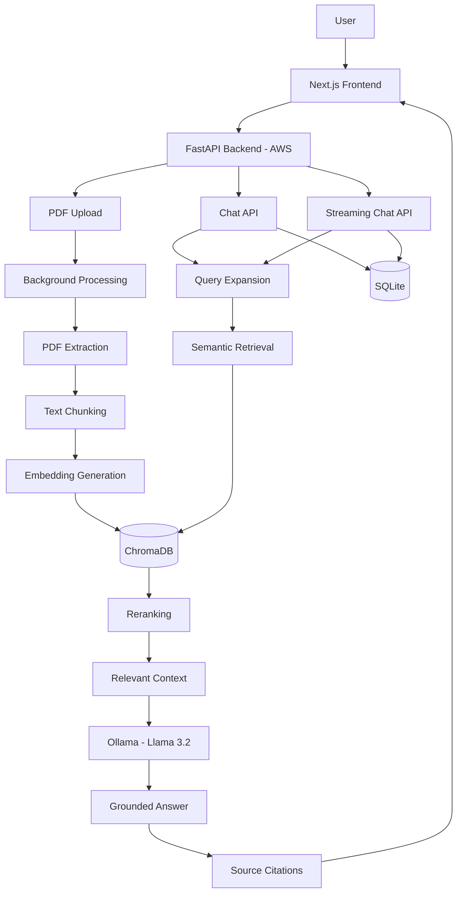
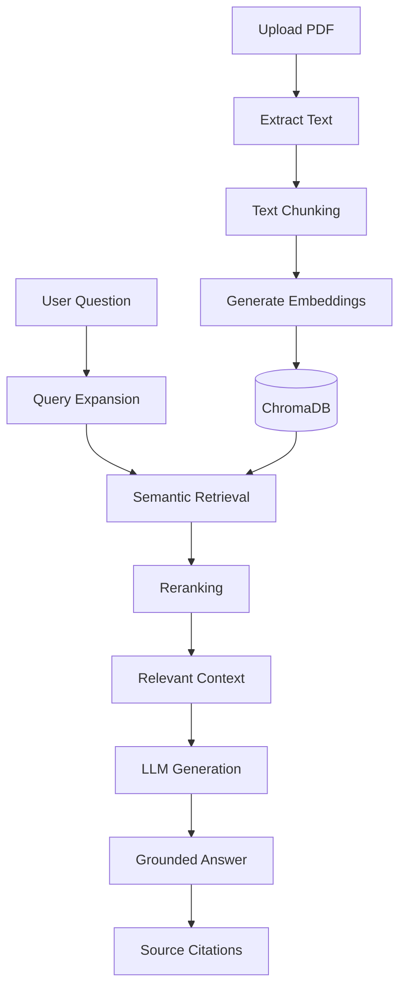
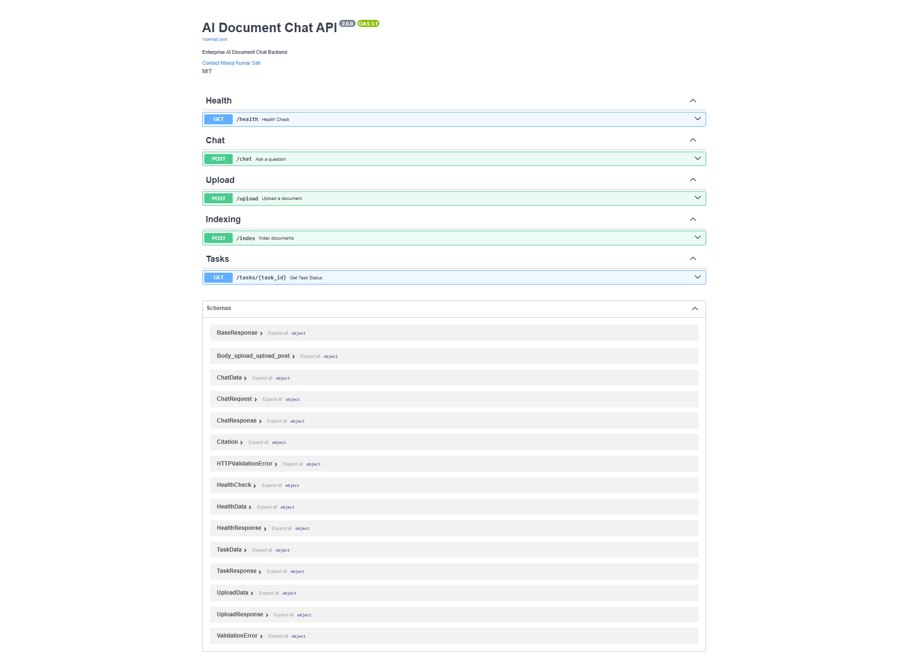
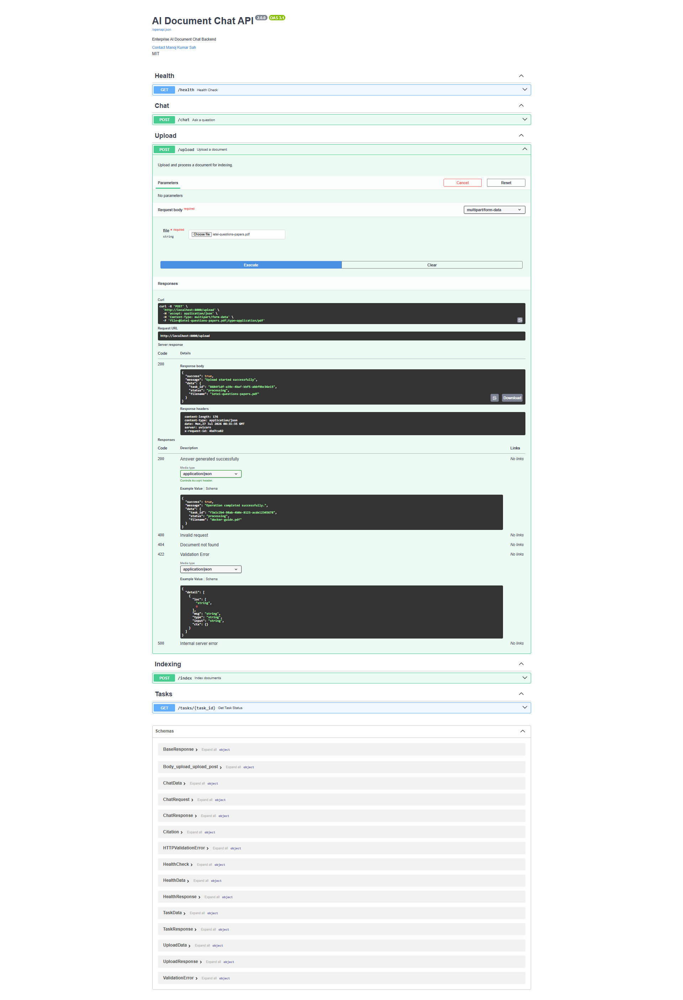
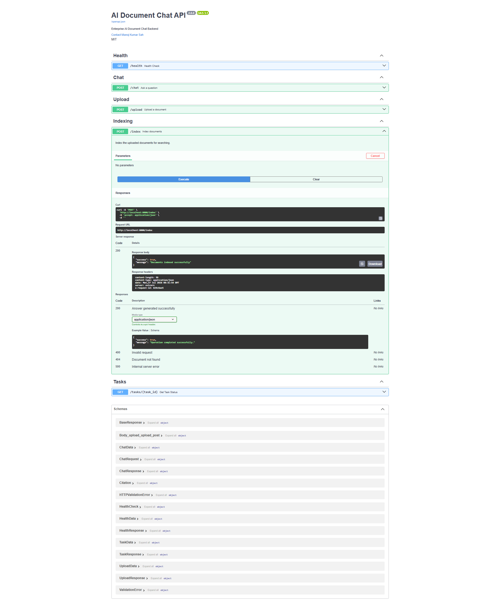
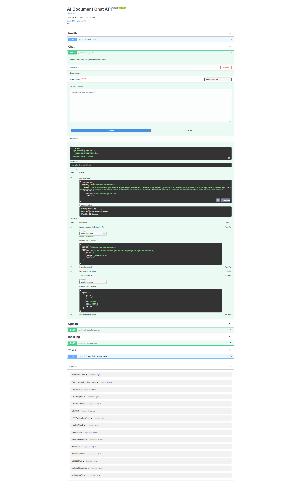
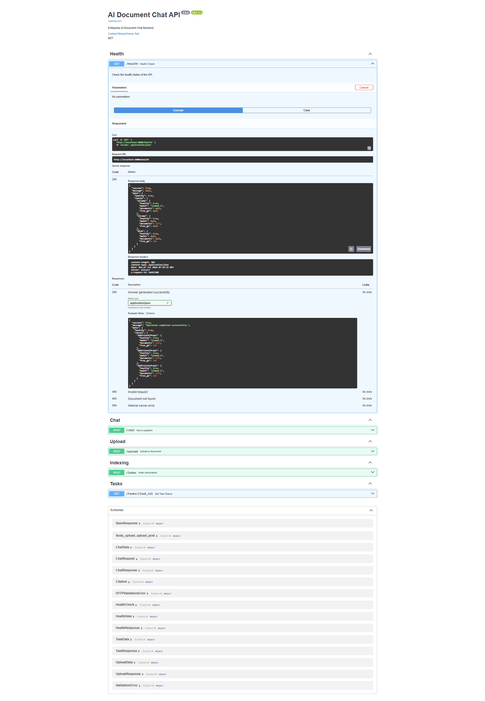
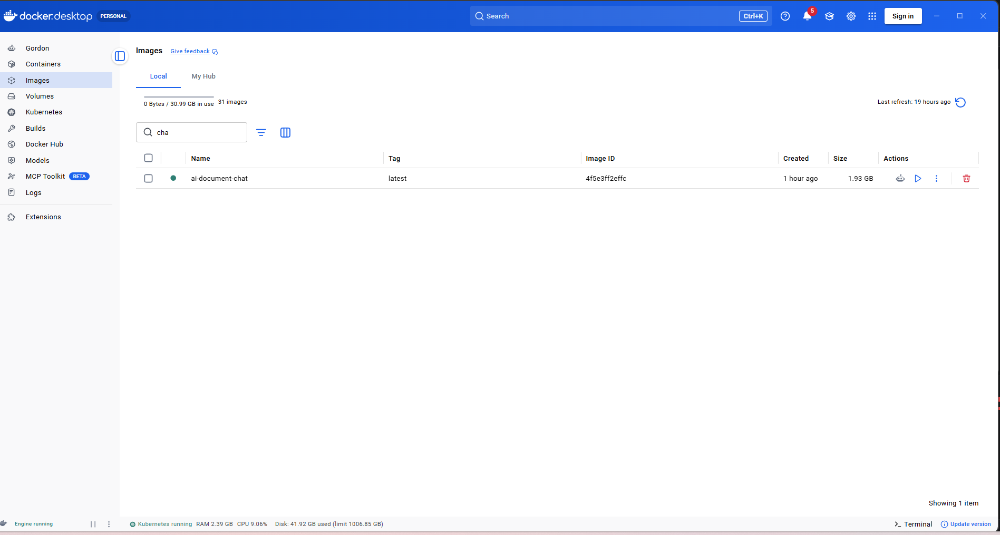

# AI Document Chat

**A document-grounded AI assistant built with RAG, FastAPI and local LLMs.**

AI Document Chat allows users to upload PDF documents, index their content and ask questions. It retrieves relevant document passages and generates answers with source citations instead of relying only on the model's general knowledge.

The application includes a Next.js frontend, a FastAPI backend deployed on AWS, ChromaDB vector storage and an Ollama-powered LLM workflow.

**Live Application:** [Open AI Document Chat](https://ai-document-chat-rag-seven.vercel.app)

**Repository:** [manojkr-ai-labs/ai-document-chat-rag](https://github.com/manojkr-ai-labs/ai-document-chat-rag)

---

## Project Overview

| Area | Implementation |
|---|---|
| Frontend | Next.js |
| Backend | Python, FastAPI |
| RAG Framework | LangChain |
| Vector Database | ChromaDB |
| LLM Runtime | Ollama |
| Generation Model | Llama 3.2 |
| Embedding Model | Nomic Embed Text |
| Conversation Storage | SQLite |
| Deployment | AWS backend, Vercel frontend |
| Containerization | Docker, Docker Compose |
| CI/CD | GitHub Actions |
| Testing | Pytest |

## The Problem

When working with large PDF documents, finding specific information manually can be time-consuming.

General-purpose AI chatbots can also produce answers that are not supported by the documents being analysed.

The goal of this project is to build an assistant that retrieves relevant document content, generates context-based answers and provides source citations.

## Key Features

**Document Processing**
- PDF upload and text extraction.
- Background document processing.
- Text chunking and embedding generation.
- Persistent vector storage using ChromaDB.

**Retrieval-Augmented Generation**
- Semantic search.
- Query expansion.
- Document retrieval and reranking.
- Relevance filtering.
- Context-grounded answer generation.
- Source citations.

**Conversational AI**
- Chat with indexed documents.
- Streaming responses.
- Persistent conversation history.
- Conversation creation, listing, retrieval, renaming and deletion.
- Conversation titles and previews.

**Backend Engineering**
- REST API architecture using FastAPI.
- Background processing and task-status tracking.
- Global exception handling.
- Structured logging.
- Health monitoring.
- Automated API and unit tests.

**Deployment and Delivery**
- Docker and Docker Compose.
- Production-oriented Compose configuration.
- GitHub Actions CI.
- AWS-hosted backend.
- Vercel-hosted frontend.

## Architecture



## RAG Pipeline

The retrieval pipeline follows these steps:



The purpose of this pipeline is to improve retrieval relevance and keep generated answers connected to the indexed document content.

## Conversation Management

The application supports persistent conversations rather than treating every question as an isolated request.

Supported operations:

- Create a conversation.
- List conversations.
- Retrieve conversation history.
- Rename a conversation.
- Delete a conversation.
- Persist user and assistant messages.
- Continue conversations through streaming chat.

SQLite is used for conversation persistence, while ChromaDB stores document embeddings.

## API Reference

| Method | Endpoint | Purpose |
|---|---|---|
| GET | `/health` | Health check |
| POST | `/upload` | Upload PDF |
| GET | `/tasks/{task_id}` | Check processing status |
| POST | `/index` | Index documents |
| POST | `/chat` | Ask questions |
| POST | `/chat/stream` | Stream responses |
| GET | `/conversations` | List conversations |
| POST | `/conversations` | Create conversation |
| GET | `/conversations/{conversation_id}` | Retrieve conversation |
| PATCH | `/conversations/{conversation_id}` | Rename conversation |
| DELETE | `/conversations/{conversation_id}` | Delete conversation |

The FastAPI service exposes interactive API documentation at `/docs` on the deployed backend.

## Evaluation and Testing

Evaluation is an important part of this project because a working chatbot does not automatically mean a reliable RAG application.

**Retrieval Evaluation**
- Evaluate whether relevant document passages are retrieved.
- Examine the impact of query expansion.
- Compare retrieval and reranking behaviour.
- Assess the relevance of retrieved context.

**RAG Evaluation**
- Evaluate generated answers against the retrieved document context.
- Examine answer relevance and faithfulness.
- Review whether answers are supported by source citations.
- Identify cases where the system fails to retrieve sufficient context.

**Automated Testing**

The project includes unit tests, API tests and regression testing using Pytest.

Latest regression result documented for this release:

- 83 tests passed.
- 1 known upstream deprecation warning.

**Important:** Numerical retrieval and answer-quality benchmark scores are not published here because no verified benchmark results have been supplied.

## Screenshots

The repository includes screenshots covering API documentation, document upload, indexing, chat, health checks, Docker Compose, GitHub Actions and project structure.

| API Documentation | Document Upload |
|---|---|
|  |  |

| Document Indexing | Chat API |
|---|---|
|  |  |

| Health Check | Docker Compose |
|---|---|
|  |  |

## Local Development

### Prerequisites

- Python 3.12
- Docker and Docker Compose
- Ollama
- Git

### 1. Clone the repository

```bash
git clone https://github.com/manojkr-ai-labs/ai-document-chat-rag.git

cd ai-document-chat-rag
```

### 2. Create a virtual environment

```bash
python -m venv venv
```

Activate on Windows:

```powershell
venv\Scripts\activate
```

Activate on Linux/macOS:

```bash
source venv/bin/activate
```

### 3. Install dependencies

```bash
pip install -r requirements.txt
```

### 4. Configure environment

Copy the example environment file:

```bash
cp .env.example .env
```

On Windows PowerShell:

```powershell
Copy-Item .env.example .env
```

Example configuration:

```properties
LLM_MODEL=llama3.2:latest
EMBEDDING_MODEL=nomic-embed-text:latest
BASE_URL=http://localhost:11434
CHROMA_DIR=storage/chroma
CHROMA_PATH=storage/chroma
DOCUMENTS_PATH=documents
TOP_K=5
RELEVANCE_THRESHOLD=1.0
EMBED_BATCH_SIZE=100
LOG_LEVEL=INFO
```

### 5. Download Ollama models

```bash
ollama pull llama3.2
ollama pull nomic-embed-text
```

### 6. Start the backend

```bash
ollama serve
```

In another terminal:

```bash
uvicorn src.api.app:app --reload --host 0.0.0.0 --port 8000
```

Open the API documentation:

```text
http://localhost:8000/docs
```

## Docker Deployment

Build the image:

```bash
docker build -t ai-document-chat .
```

Start the development environment:

```bash
docker compose up --build
```

For production-oriented local container verification:

```bash
docker compose -f docker-compose.prod.yml up -d --build
```

Check container status:

```bash
docker compose -f docker-compose.prod.yml ps
```

View logs:

```bash
docker compose -f docker-compose.prod.yml logs -f
```

The production-oriented configuration includes persistent application storage, a dedicated Docker network, restart policy and health checks.

For local Docker-to-host Ollama connectivity, configure the Ollama endpoint appropriately. The supplied production-like Compose configuration uses `host.docker.internal`.

## Deployment

The application uses separate frontend and backend deployments:

| Component | Platform |
|---|---|
| Frontend | Vercel |
| Backend API | AWS |
| Vector Storage | ChromaDB |
| Conversation Persistence | SQLite |
| LLM Integration | Ollama |

The frontend is connected to the deployed API. Configure the API base URL using the appropriate frontend environment setting.

## CI/CD

GitHub Actions runs the project's automated test workflow.

```text
Code Push
    |
    v
GitHub Actions
    |
    v
Install Dependencies
    |
    v
Run Automated Tests
    |
    v
Verification
```

Workflow status:

[](https://github.com/manojkr-ai-labs/ai-document-chat-rag/actions/workflows/test.yml)

## Project Status

**Release: v5.0 — RAG API milestone completed**

Completed:
- PDF processing and background indexing.
- Embedding generation and vector storage.
- Semantic retrieval and query expansion.
- Reranking and relevance filtering.
- Retrieval and RAG evaluation.
- Source citations.
- Streaming chat.
- Persistent conversations and CRUD APIs.
- Health checks and structured logging.
- Automated tests and GitHub Actions.
- Docker and Docker Compose.
- AWS backend and live Next.js frontend.

## Future Improvements

The following are planned enhancements, not claims of completed functionality:

- User authentication and authorization.
- Multi-user document isolation.
- PostgreSQL-based conversation persistence.
- Redis for caching and background task coordination.
- Advanced observability and monitoring.
- More comprehensive benchmark reporting.
- Further infrastructure automation and scalability improvements.

## Engineering Approach

I follow an incremental engineering workflow:

```text
Problem Definition
      |
      v
Architecture and Design
      |
      v
Implementation
      |
      v
Testing
      |
      v
Retrieval and RAG Evaluation
      |
      v
Deployment
      |
      v
Production Verification
      |
      v
Continuous Improvement
```

The objective is to build a maintainable AI application with a clear architecture, testable components and a deployment process—not just a basic PDF chatbot.

## Author

**Manoj Kumar Sah**

Full Stack Engineer | Generative AI | RAG | Agentic AI

- [GitHub](https://github.com/Manojkr6637)
- [AI Labs](https://github.com/manojkr-ai-labs)
- [LinkedIn](https://www.linkedin.com/in/manoj-kumar-sah/)

---

**License:** MIT
